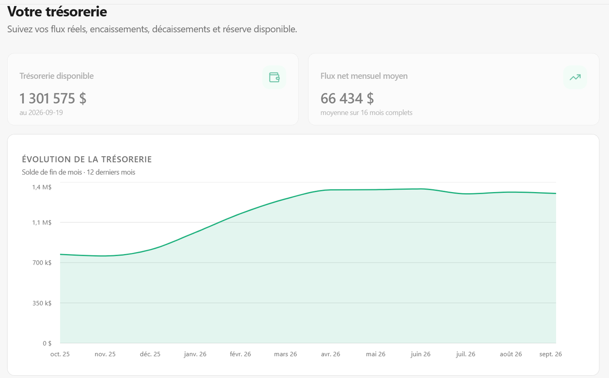
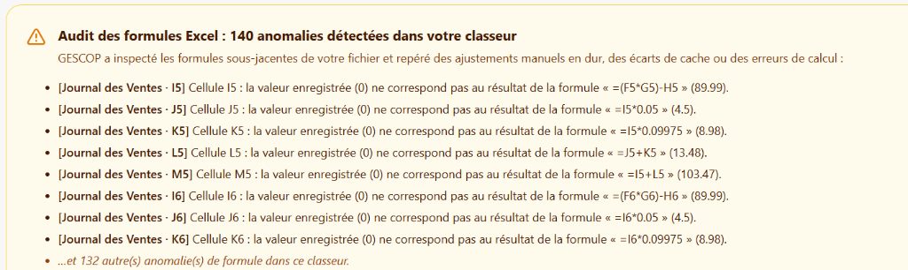
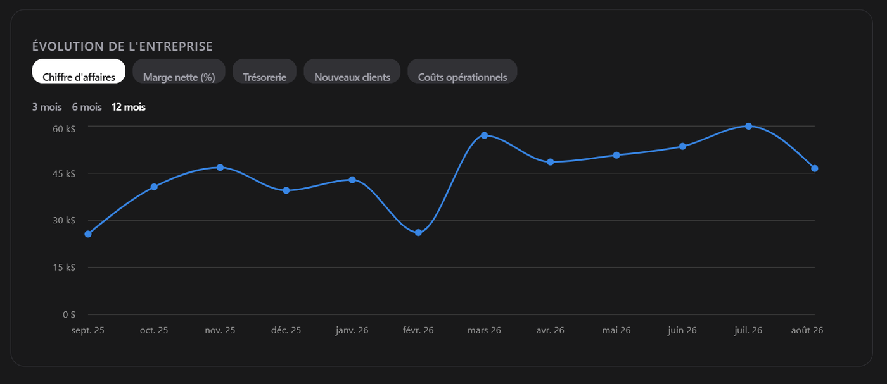
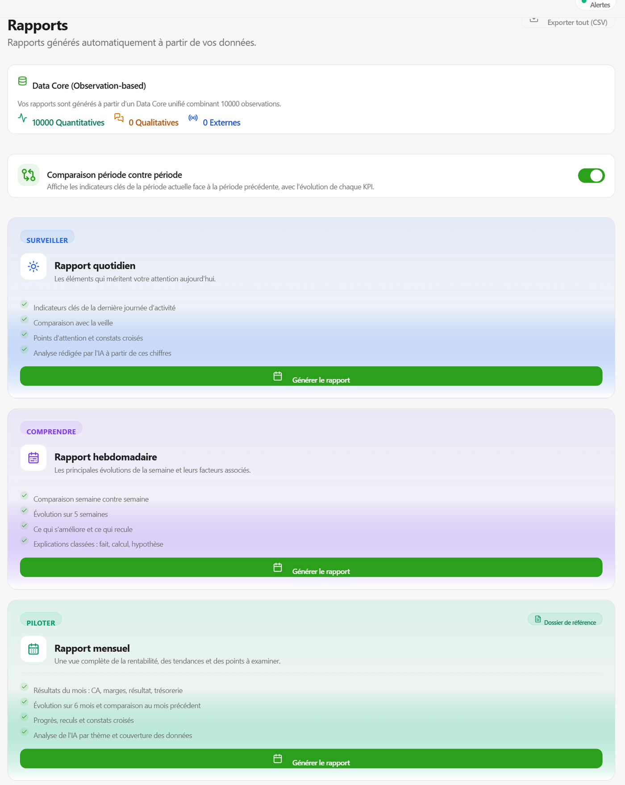
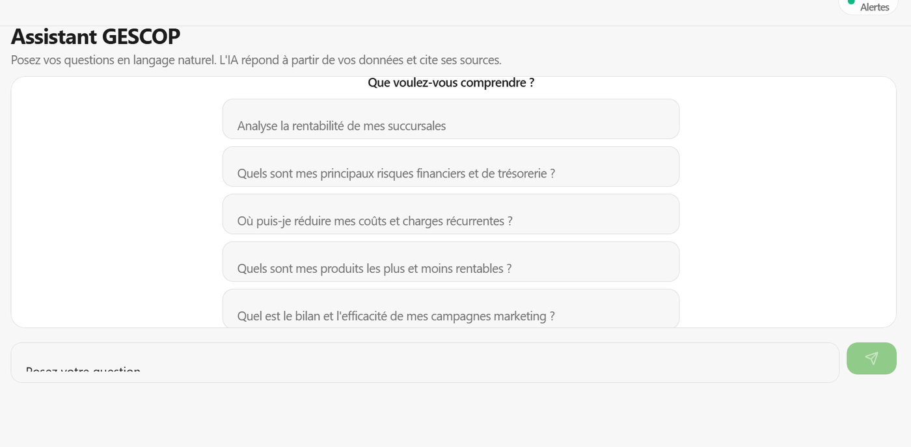

# 🧭 GESCOP · Pilotage financier, réconciliation comptable et aide à la décision pour PME


-3ECF8E?style=flat&logo=supabase&logoColor=white)
-000000?style=flat&logo=deno&logoColor=white)


Application web SaaS conçue pour les PME et commerces, qui transforme les fichiers bruts et hétérogènes (ventes POS, dépenses, factures, paie, relevés bancaires, stocks) en un tableau de bord financier traçable, déterministe et immédiatement exploitable pour la prise de décision.

> 🌐 **Application en production : [gescop.ca](https://gescop.ca)** *(ou accès direct à l'[application de pilotage](https://gescop.ca/application))*, développée et opérée par GESCOP, cabinet de conseil et d'intégration de solutions d'affaires pour PME ([gescop.ca](https://gescop.ca)).
>
> 🚀 **Tester sans inscription :** [Démonstration interactive en 1 clic](https://gescop.ca/importer) avec un jeu de données réaliste consolidé multi-succursales (commerce de détail, services, transactions de caisse).
>
> 📥 **Gabarit officiel téléchargeable :** [Nordik Groupe Consolidé (.xlsx)](https://gescop.ca/demo/Nordik_Groupe_Consolide_2025_2026.xlsx) pour tester l'ingestion avec vos propres données.
>
> 📖 **Manuel d'utilisation interactif v2.2 :** [Consulter le manuel en direct](https://gescop.ca/manuel) intégrant le guide des colonnes, la fiscalité québécoise (TPS/TVQ) et le référentiel des formules.
>
> 🔒 *Le code source est propriétaire : GESCOP est un produit commercial en exploitation. Cette page documente les défis de gestion résolus, l'architecture logicielle, les choix algorithmiques et ce qui rend les chiffres rigoureusement fiables.*



---

## 🧩 Contexte métier : la réalité des chiffres en PME

Dans la grande majorité des PME, les données financières et opérationnelles existent, mais elles sont éparpillées dans des silos logiciels qui ne communiquent pas :
- le **logiciel de caisse ou de facturation** (Square, Clover, Lightspeed, Shopify) ;
- les **tableurs Excel ou LibreOffice** remplis à la main par les équipes de vente ou de gestion ;
- les **relevés bancaires au format PDF** (Desjardins, BNC, RBC, TD) ;
- le **registre de paie** chez un fournisseur externe (Nethris, Desjardins, ADP) ;
- les statistiques des régies publicitaires (Google Ads, Meta Ads).

### Les 4 angles morts qui mettent en danger les dirigeants

1. **L'illusion des formules de tableurs et les ajustements manuels en dur :**  
   Dans la pratique, les classeurs Excel manipulés par plusieurs intervenants contiennent fréquemment des formules écrasées par inadvertance avec des valeurs en dur (`0` ou montants fixes), ou des cellules sans mise à jour automatique. Le dirigeant consulte un total erroné sans jamais être alerté.
2. **La marge nette réelle découverte trop tard :**  
   Sans rapprochement continu entre les ventes brutes, les remises, le coût direct d'achat et les frais réels de passerelle bancaire (Stripe, Moneris), la rentabilité réelle n'est connue qu'au bilan comptable annuel, plusieurs mois après la prise de décision.
3. **Le piège fiscal des taxes québécoises et canadiennes (TPS 5% / TVQ 9.975%) :**  
   Mélanger des colonnes Toutes Taxes Comprises (TTC) et Hors Taxes (HT) dans les analyses de marge fausse complètement le calcul du seuil de rentabilité et expose l'entreprise à des déficits de liquidités lors des remises de taxes à Revenu Québec.
4. **La trésorerie pilotée à l'aveugle :**  
   Regarder le solde bancaire sur son téléphone ne donne aucune visibilité sur les décaissements fournisseurs (DPO), les prélèvements de paie du 15 et du 30 du mois, ni le délai réel de règlement des clients (DSO).

---

## 🎯 Objectif de GESCOP

Permettre à un dirigeant ou un gestionnaire de PME, **sans aucune compétence technique**, de glisser-déposer ses fichiers bruts tels qu'ils sortent de ses outils quotidiens, et d'obtenir en quelques secondes :
- une **vérité financière unifiée et déterministe** ;
- des **indicateurs audités cellule par cellule**, traçables jusqu'au fichier et à la ligne d'origine ;
- une **détection immédiate des anomalies, doublons et erreurs de formules** ;
- des **recommandations d'action concrètes** pour protéger la marge et la trésorerie.

---

## 🔬 Nouveauté majeure : Le Moteur d'Audit Déterministe des Formules

Les solutions classiques de Business Intelligence échouent dès qu'un fichier Excel contient des formules non recalculées ou des valeurs forcées. GESCOP intègre un **moteur d'inspection syntaxique (AST) et d'audit déterministe** capable d'analyser en profondeur les formules francophones et anglophones (`SOMME`, `SI`, `RECHERCHEV`, `SUM`, `IF`, calculs arithmétiques imbriqués) :



### Ce que ce moteur accomplit :
- **Détection des valeurs écrasées en dur :** Repère instantanément si une cellule contient une formule valide mais dont la valeur enregistrée a été forcée manuellement (par exemple, des colonnes de TPS, TVQ ou sous-total affichant `0` au lieu du calcul réel).
- **Rapprochement du cache Excel :** Reconstitue mathématiquement le graphe de dépendance des cellules et recalcule les vraies valeurs à la volée avant toute intégration comptable.
- **Transparence absolue pour l'utilisateur :** Chaque anomalie est répertoriée avec sa coordonnée précise (ex. `[Journal des Ventes · I5]`), la formule sous-jacente et le résultat exact attendu.

---

## ⚙️ Ce que fait l'application : Les 10 modules fonctionnels

| Module | Fonctionnalités & Rôle métier |
|---|---|
| **Audit des formules Excel & ODS** | Inspection récursive de l'arbre des formules. Recalcul déterministe à l'ingestion, détection des anomalies de cache et des cellules écrasées à la main. |
| **Import universel & Multi-formats** | Dépôt par glisser-déposer de fichiers `.xlsx`, `.xls`, `.ods`, `.csv`, `.tsv` et `.pdf`. Reconnaissance automatique des colonnes par ontologie contextuelle sans forcer de gabarit rigide. |
| **Extraction déterministe de PDF** | Parsing tabulaire géométrique pour les relevés bancaires et factures numériques avec vérification comptable immédiate (débit = crédit). Pas de dépendance aléatoire à un LLM. |
| **Ontologie Commerciale V3** | Modélisation unifiée sur 30 familles d'entités métier (`Order`, `Invoice`, `Payment`, `Expense`, `Payroll`, `Inventory`, `Customer`, `Supplier`, `ExecutiveSummary`...). Détection automatique de la granularité (transaction unitaire, récapitulatif journalier, bordereau). |
| **Catalogue de 100+ KPIs** | Calcul instantané du P&L complet : CA hors taxes, marges brute et nette, EBITDA, ratios de masse salariale, BFR, DSO (délai client), DPO (délai fournisseur), DIO (rotation des stocks), seuil de rentabilité / point mort. |
| **Trésorerie & Rapprochement bancaire** | Lettrage automatique entre les relevés bancaires, les ventes POS et les dépenses. Prévisions glissantes de trésorerie à 30, 60 et 90 jours avec scénarios de stress. |
| **Radar économique externe** | Intégration en continu des signaux macroéconomiques canadiens (taux directeurs de la Banque du Canada, indice des prix à la consommation / IPC de Statistique Canada, actualités sectorielles). |
| **Alertes proactives & Plan d'action** | Surveillance continue des risques (perte de marge, dérive salariale, factures impayées) et génération d'un plan d'action d'exploitation avec chiffrage des gains potentiels. |
| **Assistant IA d'affaires cadré** | Questions-réponses en langage naturel sur les données financières réelles de l'entreprise, avec citation obligatoire des sources chiffrées (RAG déterministe sans extrapolation). |
| **Rapports de direction en 1 clic** | Édition instantanée de bilans exécutifs quotidiens, hebdomadaires et mensuels, exportables en PDF haute définition, classeurs Excel et diaporamas PowerPoint. |

---

### Aperçu de l'interface

**Évolution de l'entreprise** : chiffre d'affaires mois par mois sur 12 mois, avec bascule vers la marge, la trésorerie, les nouveaux clients ou la structure de coûts.



**Rapports exécutifs** : rapports quotidien, hebdomadaire et mensuel générés automatiquement à partir des flux rapprochés.



**Assistant conversationnel d'affaires** : réponses précises basées sur la base de données de l'entreprise, avec rappel systématique des sources utilisées.



---

## 🏗️ Architecture technique & Flux de données

```
Fichiers PME (Excel, ODS, CSV, PDF, Presse-papiers)
                     │
                     ▼
Couche d'Ingestion & Audit Déterministe
  ├─ Inspecteur AST & Recalculateur de Formules (preparerClasseurPourImport)
  ├─ Détecteur de Granularité & Ontologie Métier V3 (30 entités)
  └─ Extracteur Tabulaire Déterministe de PDF
                     │
                     ▼
Edge Functions Serveur (Deno / TypeScript sur Supabase)
  importData · importMultiData · inspectSheet · reprocessImport · resolveDuplicate
  → validation de schéma, assainissement, normalisation multi-devises (CAD/USD)
                     │
                     ▼
Stockage Sécurisé & Chiffré (PostgreSQL 15 + Row Level Security)
  ├─ Isolation stricte par organisation (Multi-tenant RLS)
  └─ Quarantaine des anomalies & Historique d'audit immuable
                     │
                     ▼
Moteur de Calcul Financier Déterministe
  ├─ Registre unifié de 100+ KPI (P&L, Marges, BFR, Ratios d'exploitation)
  └─ Modélisation de trésorerie glissante (30, 60, 90 jours)
                     │
                     ▼
Interface Utilisateur React 18 & Vite (Hébergement Netlify CDN Edge)
  Tableaux de bord interactifs · Radar externe · Alertes · Rapports 1 clic
```

### Stack technologique retenue

| Composant | Technologie & Rôle |
|---|---|
| **Interface Frontend** | React 18, Vite, Tailwind CSS, composants Radix UI, TanStack Query, Recharts, Lucide Icons |
| **Plateforme Backend & Base** | Supabase (PostgreSQL 15 avec Row Level Security, authentification sécurisée, stockage chiffré) |
| **Logique Serveur (Edge)** | 17 Edge Functions Deno 2.x en TypeScript (traitement asynchrone des imports volumineux jusqu'à 50 000 lignes) |
| **Hébergement & CDN** | Netlify Edge Network (déploiement continu, SSL automatisé, temps de réponse sous 50 ms) |
| **Moteur d'Audit de Tableurs** | Parseur de formules Excel/ODS, graphe de dépendance de cellules et recalcul déterministe |
| **Génération Documentaire** | jsPDF, SheetJS / ExcelJS, PptxGenJS (génération côté client sans transfert de données vers des serveurs tiers) |
| **Monétisation** | Stripe Billing (abonnements mensuels/annuels, gestion du portail client et webhooks cryptés) |
| **Conformité & Sécurité** | Chiffrement TLS 1.3 / AES-256, isolation RLS, conformité stricte **Loi 25 québécoise** et RGPD |

**Métriques de développement vérifiables :**
- **90 000+ lignes de code applicatif** (React, TypeScript, Deno, SQL).
- **892 tests automatisés de non-régression** (unitaires, intégration, calculs financiers, ingestion de fichiers complexes).
- **17 Edge Functions serveur**.
- **800+ commits** documentés.
- **30+ écrans interactifs** couvrant la totalité des opérations PME.

---

## ✅ Fiabilité : des chiffres sur lesquels un dirigeant peut décider

Un tableau de bord qui affiche un chiffre faux est plus dangereux que l'absence de tableau de bord. La fiabilité de GESCOP repose sur 5 piliers intransigeants :

1. **Traçabilité totale jusqu'à la cellule d'origine :**  
   Chaque chiffre affiché peut être inspecté : en un clic, le dirigeant visualise exactement les lignes, le fichier source et la méthode de calcul ayant produit le résultat.
2. **Déterminisme mathématique absolu :**  
   Aucun calcul financier n'est délégué à un modèle de langage (LLM). L'IA intervient uniquement comme aide contextuelle à la catégorisation sémantique, mais tous les indicateurs sont calculés par des algorithmes mathématiques déterministes.
3. **Mise en quarantaine plutôt que suppression silencieuse :**  
   Une ligne incomplète, un doublon suspect ou un écart de montant n'est jamais masqué ni supprimé en silence. L'anomalie est isolée dans le journal d'importation avec explication claire de la cause.
4. **Confrontation des sources contradictoires :**  
   Quand deux sources se contredisent (par exemple, les ventes revendiquées par une campagne publicitaire face aux encaissements réels en banque), GESCOP met en évidence l'écart chiffré :


5. **Journal d'audit accessible en direct :**  
   L'écran « Audit des calculs » permet à tout moment de contrôler l'intégrité de la base de données par rapport aux fichiers originaux déposés :


---

## 🧠 Règles métier fondamentales (et pourquoi)

Concevoir un outil de gestion pour PME exige des prises de position nettes face à des données incomplètes ou ambiguës :

- **Corriger l'algorithme d'ingestion, jamais le fichier du client :**  
  Lorsqu'un format de fichier atypique pose problème, nous enrichissons le moteur de reconnaissance universel pour que l'ensemble des fichiers similaires soient compris sans obliger le client à modifier ses habitudes.
- **Les doublons ne sont pas automatiquement effacés :**  
  Dans le commerce, deux ventes du même montant à la même minute peuvent correspondre à deux clients distincts à deux caisses différentes. GESCOP signale l'ambiguïté et donne le contrôle final au gestionnaire.
- **Isolation stricte des taxes (TPS/TVQ) :**  
  Les taxes collectées pour le gouvernement ne constituent jamais du chiffre d'affaires. Tous les KPIs de rentabilité sont calculés strictement Hors Taxes (HT) pour éviter toute fausse impression de richesse.
- **Recalcul prioritaire sur la valeur en cache :**  
  Si un fichier Excel contient à la fois une formule et un résultat en cache en désaccord, GESCOP recalcule la formule et avertit immédiatement l'utilisateur de l'écart.

---

## 🤖 Méthode de conception & Développement

GESCOP a été conçu et développé selon une démarche rigoureuse d'ingénierie logicielle assistée par IA, telle que détaillée dans [Intégration IA au flux de travail](../integration-ia/) :
- **Rôle d'Issa Ouedraogo :** Définition de la vision produit, modélisation des règles de gestion financière, conception de l'ontologie d'affaires, supervision de l'architecture, validation sur des données de terrain PME et garantie de la conformité réglementaire.
- **Rôle des agents IA :** Accélération de l'implémentation de composants, écriture exhaustive de jeux de tests automatisés (892 tests) et exploration des cas limites d'ingestion de fichiers.

---

## 📚 Enseignements clés du projet

- **La valeur réside dans la réconciliation, pas dans les graphiques :** N'importe quel outil sait dessiner une courbe ; la vraie difficulté est de s'assurer que les données qui alimentent la courbe sont exemptes de doublons, de biais fiscaux et d'erreurs de formule.
- **La confiance se gagne par l'auditabilité :** Un dirigeant n'adoptera jamais un tableau de bord s'il ne peut pas vérifier le montant de sa propre facture ou de sa marge nette ligne par ligne.
- **Le terrain dicte la robustesse :** Les fichiers réels d'entreprises ne ressemblent jamais aux tutoriels de programmation. Bâtir un produit utilisable nécessite d'anticiper toutes les anomalies humaines et logicielles imaginables.

---

## 📬 Contact & Démonstration

Vous souhaitez échanger sur GESCOP, organiser une démonstration personnalisée pour votre entreprise ou collaborer sur un projet d'analyse de données et d'outils de gestion ?

**Issa Ouedraogo**  
*Fondateur de GESCOP · Gestion de commerce & Solutions d'affaires*  
📍 Québec, Canada  
📧 [issaouedraogo0900@gmail.com](mailto:issaouedraogo0900@gmail.com) / [gescop.support@gmail.com](mailto:gescop.support@gmail.com)  
💼 [Profil LinkedIn](https://www.linkedin.com/in/issa-ouedraogo-34b146332/)  
🌐 [Application GESCOP en direct](https://gescop.ca)

[← Retour au portfolio](../)
